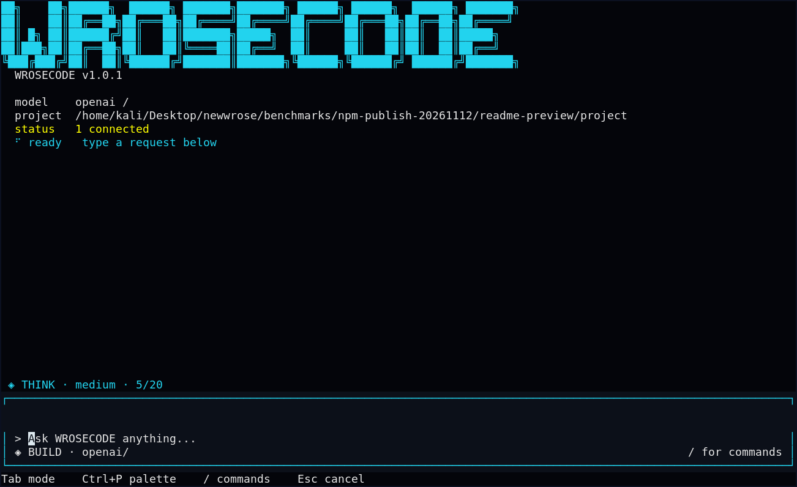
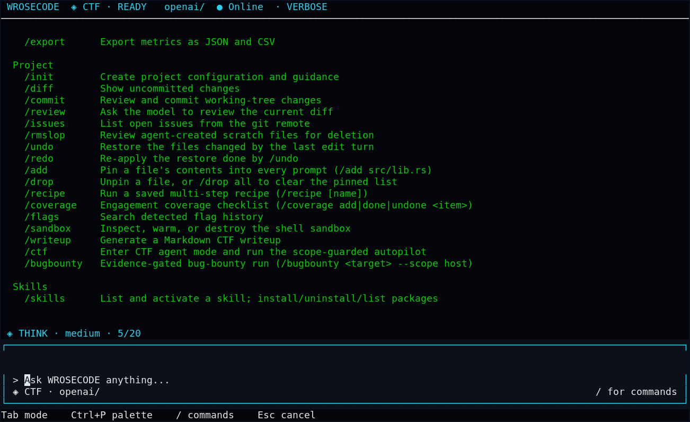
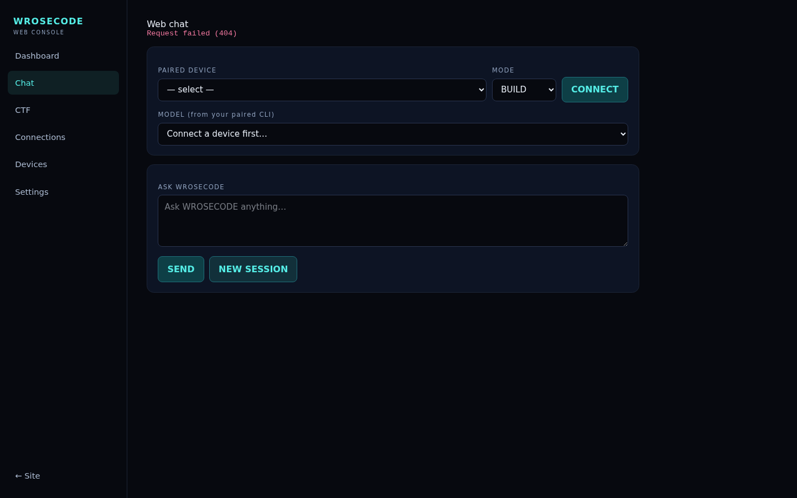
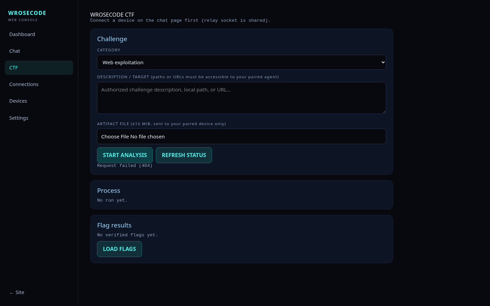

<p align="center">
  
</p>

<h1 align="center">WROSECODE</h1>

<p align="center">
  <strong>A native Rust AI coding agent for your terminal.</strong><br>
  <em>Build software. Explore code. Solve authorized CTF labs. Document security findings.</em>
</p>

<p align="center">
  <a href="https://github.com/whiterose717/WROSECODE-CLI/actions/workflows/ci.yml"></a>
  <a href="https://www.npmjs.com/package/wrosecode"></a>
  <a href="LICENSE"></a>
  <a href="https://www.rust-lang.org/"></a>
  
</p>

<p align="center">
  <a href="#installation"><strong>Get started</strong></a> ·
  <a href="#screenshots">Screenshots</a> ·
  <a href="#features">Features</a> ·
  <a href="#security-research-workflows">CTF &amp; VAPT</a> ·
  <a href="#documentation">Documentation</a>
</p>

---

WROSECODE combines a streaming, keyboard-driven **terminal UI** with repository-aware tools, configurable AI providers, persistent sessions, optional MCP integrations, built-in checks, and controlled execution. It is designed for everyday development and for **permissioned** CTF, VAPT, and bug-bounty workflows.

> [!NOTE]
> The `main` branch contains the v1.0.1 source update. The public npm version is shown by the npm badge above and may be older until the corresponding native GitHub Release is published.

## Screenshots

### Native Rust terminal UI

Real screenshots captured from the WROSECODE executable using an isolated demo workspace, without account credentials or real target data.

<div align="center">
  <a href="docs/assets/terminal-start.png"></a>
  <sub>Start screen · provider and mode overview · compact status footer</sub>
</div>

<br>

<div align="center">
  <a href="docs/assets/terminal-commands.png"></a>
  <sub>Built-in command help and keyboard-first navigation</sub>
</div>

### Optional companion Web Console

These are previews of the **separate companion Web Console**, not the native CLI window. Connecting a device and configuring a backend may be required to use them.

| Web chat | CTF workbench |
|:--:|:--:|
| <a href="docs/assets/web-console-chat.png"></a> | <a href="docs/assets/web-console-ctf.png"></a> |
| Paired-device chat and agent mode selection | Local challenge input, analysis workflow and results panel |

## Installation

### Option 1 — npm (recommended for end users)

Requires **Node.js 18+** and network access on the first installation/run to download the native executable.

```bash
npm install -g wrosecode
wrosecode --version
wrosecode
```

Run without a permanent installation:

```bash
npx wrosecode
```

Update or uninstall:

```bash
npm install -g wrosecode@latest
npm uninstall -g wrosecode
```

The npm package is a small JavaScript launcher, not a bundled Rust binary. It downloads the **matching native release asset** from [GitHub Releases](https://github.com/whiterose717/WROSECODE-CLI/releases) and verifies its **SHA-256 checksum**. If your npm version disables lifecycle scripts by default, the launcher downloads the verified binary when first run.

Supported native release targets: **Linux x86_64 / ARM64**, **macOS x86_64 / Apple Silicon**, and **Windows x86_64 / ARM64**. Availability depends on the corresponding GitHub Release assets.

> Installing a version before its matching GitHub Release exists will not work. If `npm install -g` encounters a permission conflict with an older system-wide binary, use a user-owned npm prefix or back up the old binary first; do not weaken system directory permissions.

### Option 2 — build from Rust source

Install a supported Rust toolchain and Cargo, then:

```bash
git clone https://github.com/whiterose717/WROSECODE-CLI.git
cd WROSECODE-CLI
cargo build --release --locked
./target/release/wrosecode --version
./target/release/wrosecode
```

You can also install the checked-out source using `cargo install --path . --locked`.

## Quick start

Open the CLI from the repository you want to work in:

```bash
cd /path/to/your/project
wrosecode
```

Try a one-shot development task:

```bash
wrosecode --mode build "Review this repository and suggest a small, testable improvement."
```

Inside the interactive UI:

```text
/help        Show available commands
/providers   Configure, authenticate, or test model connections
/ctf         Open the CTF workflow
/bugbounty   Arm a scoped security assessment
/resume      Continue a saved session
Ctrl+T       Change thinking level
Ctrl+D       Open the dashboard
```

For provider setup, use `/providers` or the supported environment variables. **Never put API keys in Git commits, README examples, or issue screenshots.**

## Features

| Capability | What it provides |
|---|---|
| **Native Rust TUI** | Responsive, streaming, keyboard-first interface with compact resource and progress information |
| **Multiple AI backends** | Provider profiles, compatible APIs and configurable model/thinking choices |
| **Repository awareness** | File context, project instructions, repository maps, code editing and local test workflows |
| **Tool integration** | Shell tools, optional MCP providers and developer workflows with permission controls |
| **Persistent sessions** | Resumable conversations, checkpoints, exports and session diagnostics |
| **Headless execution** | CLI automation, machine-readable events, budgets and bounded run limits |
| **CTF mode** | Challenge analysis, local solver development and evidence-based flag verification |
| **VAPT / Bug Bounty** | Program allowlists, OWASP-oriented checklists, controlled authorization testing and evidence-backed reports |

Features requiring a provider account, an external app, MCP server or other optional service are **not** enabled automatically.

## Security research workflows

WROSECODE supports **authorized research only**. Set an explicit target scope and follow the program's testing rules. Do not use production customer data, attack out-of-scope infrastructure or assume automated findings are verified.

### CTF labs

Use the interactive `/ctf` workflow or a task with CTF mode:

```bash
wrosecode --mode ctf
```

Analyze challenge material you are allowed to test, build a reproducible solver, and confirm the result with tool output. A model-generated flag alone is **not** proof of a solved challenge.

### VAPT and bug bounty

Example syntax using a **placeholder domain**; replace it with the exact host authorized by your program:

```bash
wrosecode bugbounty https://app.example.test \
  --scope app.example.test \
  --program "Authorized Assessment"
```

The engagement workflow can create `.bugbounty/VAPT_ASSESSMENT.md`, containing an offline **OWASP WSTG / ASVS** checklist and an **API BOLA/IDOR role-object matrix** for researcher-owned test accounts. Scope guardrails, bounded HTTP behavior, response/evidence checks, and report verification support low-impact testing; they do not substitute for explicit authorization.

Findings follow an evidence-gated process:

```text
Potential → Investigating → Reproduced → Verified → Reported
```

Verified reports can include analyst-supplied **CWE, WSTG, ASVS, CVSS vector, severity rationale**, reproduction steps and remediation. Unconfirmed scanner hits should not be presented as confirmed vulnerabilities.

## Permissions and responsible use

- Start with interactive approval (`ask`) or the appropriate bounded permission mode. Do not use broad `yolo` permissions on untrusted code or systems.
- Keep test data synthetic, honor target exclusions and rate limits, and stop testing when the program or service blocks requests.
- Keep credentials, CTF flags, raw request/response captures and personal data out of public issues and screenshots.
- See [sandbox implementation details](docs/CLI_REFERENCE.md#shell-sandbox) and [contribution guidance](CONTRIBUTING.md).

## Development and quality checks

The release workflow uses Rust and Node.js checks. From a source checkout:

```bash
npm ci --ignore-scripts
npm run check
cargo fmt --check
cargo clippy --all-targets -- -D warnings
cargo test --all-targets
cargo build --release --locked
```

CI runs on **Linux, macOS and Windows**. The CI badge reports the current public workflow status; it is not a guarantee that every optional external provider is available.

## Documentation

| Resource | Description |
|---|---|
| [Full CLI reference](docs/CLI_REFERENCE.md) | Original detailed README content, including TUI controls, providers and advanced workflows |
| [Architecture](ARCHITECTURE.md) | Internal design and components |
| [Feature reference](docs/features.md) | Detailed capabilities |
| [Agent API](API.md) | Local API and integration notes |
| [Benchmarks](BENCHMARKS.md) | Benchmark notes and methodology |
| [Contributing](CONTRIBUTING.md) | Development and testing expectations |
| [GitHub releases](https://github.com/whiterose717/WROSECODE-CLI/releases) | Native releases, versioned binaries and checksums |

## License

WROSECODE is open source under the **MIT License**.

See the complete [LICENSE](LICENSE) file for legal terms and copyright information. The existing license text and attribution are preserved.

---

<div align="center">

**Built for the terminal. Grounded in reproducible work.**

[GitHub](https://github.com/whiterose717/WROSECODE-CLI) · [npm](https://www.npmjs.com/package/wrosecode) · [Releases](https://github.com/whiterose717/WROSECODE-CLI/releases) · [Issues](https://github.com/whiterose717/WROSECODE-CLI/issues)

</div>
